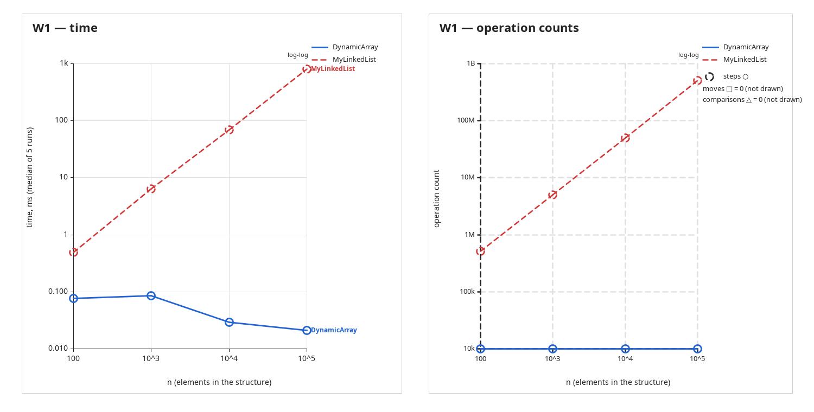
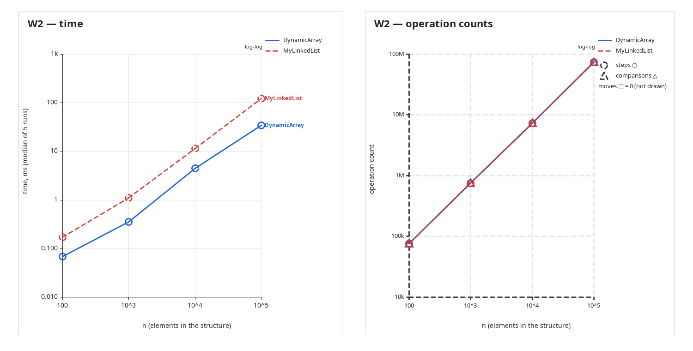
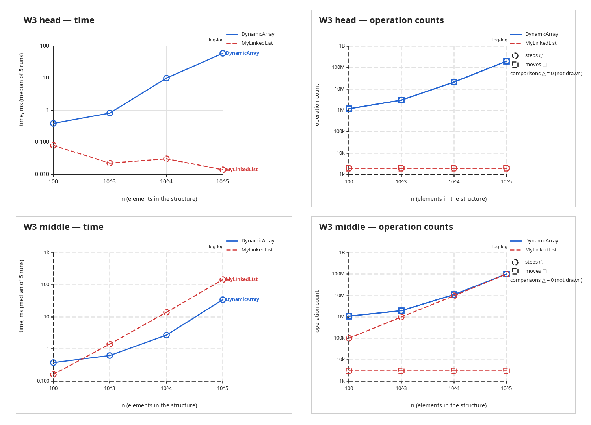
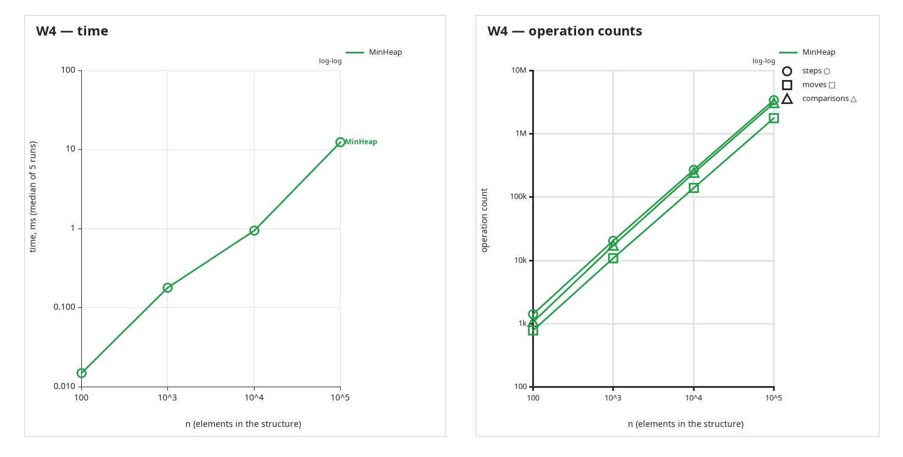

# DAA Assignment 2 — Data Structures

## 1. Overview

This project implements three integer data structures from scratch:

- `DynamicArray` — primitive `int[]` with capacity growth by a factor of 2.
- `MyLinkedList` — custom singly linked list with `head`, `tail`, and `size`.
- `MinHeap` — array-based binary min-heap with bubble-up and bubble-down.

`DynamicArray` and `MyLinkedList` implement the common `IntList` interface, so W1–W3 use the same benchmark logic. No Java collection classes are used inside the required data structures.

## 2. Design and metric definitions

### DynamicArray

`add(x)` appends at the end. If the backing array is full, `grow()` allocates an array twice as large and copies the existing elements. `add(index, x)` shifts the suffix right before insertion. `remove(index)` shifts the suffix left. `get(index)` uses direct array indexing. `contains(x)` scans the array until a match is found or the end is reached.

### MyLinkedList

The list stores values in custom nodes. `tail` makes `add(x)` constant time. Indexed operations first follow links from `head`; insertion and removal then update only the links that actually change. Traversing a node does **not** count as a move because no reference is updated.

### MinHeap

The heap stores values in an `int[]`. For index `i`, the parent is `(i - 1) / 2`, while the children are `2*i + 1` and `2*i + 2`. `insert(x)` restores the min-heap property by bubble-up. `extractMin()` moves the last value to the root and restores the property by bubble-down.

### Counter definitions used in the benchmark

| Structure | `steps` | `moves` | `comparisons` |
|---|---|---|---|
| `DynamicArray` | Reading an array cell; loop iterations that access a cell | Copying/shifting an element to another array cell | Value comparisons in `contains` and heap comparisons where applicable |
| `MyLinkedList` | Visiting/following a node | Updating one reference (`next`, `head`, or `tail`) | Value comparisons in `contains` |
| `MinHeap` | Reading/processing a heap position | Swapping or copying a heap element | Parent/child value comparisons |

This separation is important: a linked-list traversal increases `steps`, but it does not increase `moves` because the links are only read.

## 3. Complexity analysis

| Structure | Operation | Best | Average / expected | Worst single call | Auxiliary space | Justification |
|---|---|---:|---:|---:|---:|---|
| DynamicArray | `add(x)` | Θ(1) | Θ(1) amortized | Θ(n) | Θ(n) during resize | Usually writes one cell; a full array requires copying. |
| DynamicArray | `add(i,x)` | Θ(1) | Θ(n) | Θ(n) | Θ(n) during resize | A suffix may be shifted; resize may also copy the backing array. |
| DynamicArray | `remove(i)` | Θ(1) | Θ(n) | Θ(n) | Θ(1) | Removing the last item needs no shift; earlier positions shift a suffix. |
| DynamicArray | `get(i)` | Θ(1) | Θ(1) | Θ(1) | Θ(1) | Direct array indexing. |
| DynamicArray | `contains(x)` | Θ(1) | Θ(n) | Θ(n) | Θ(1) | A match may be first, or the whole array may be scanned. |
| MyLinkedList | `add(x)` | Θ(1) | Θ(1) | Θ(1) | Θ(1) | `tail` points to the last node. |
| MyLinkedList | `add(i,x)` | Θ(1) | Θ(n) | Θ(n) | Θ(1) | Head/end insertion is constant; indexed insertion may require traversal. |
| MyLinkedList | `remove(i)` | Θ(1) | Θ(n) | Θ(n) | Θ(1) | Removing the head is constant; other indexes may require traversal. |
| MyLinkedList | `get(i)` | Θ(1) | Θ(n) | Θ(n) | Θ(1) | The list follows links from the head. |
| MyLinkedList | `contains(x)` | Θ(1) | Θ(n) | Θ(n) | Θ(1) | A match can occur early; otherwise the list is scanned. |
| MinHeap | `insert(x)` | Θ(1) | Θ(1) expected for random data | Θ(n) | Θ(n) during resize; Θ(1) otherwise | Without resize, bubble-up is at most Θ(log n); a resize copies the array in Θ(n). With geometric growth, resizing is amortized constant work. |
| MinHeap | `peekMin()` | Θ(1) | Θ(1) | Θ(1) | Θ(1) | Minimum is stored at index 0. |
| MinHeap | `extractMin()` | Θ(1) | Θ(log n) | Θ(log n) | Θ(1) | The replacement can move down through the heap. |

The data structures themselves use Θ(n) storage. During `DynamicArray` or `MinHeap` resizing, a second backing array is temporarily allocated, so the auxiliary space of that particular operation is Θ(n).

## 4. Loop invariant proofs

### Invariant 1 — `DynamicArray.remove(index)`

**Invariant:** Before each iteration of the shift loop, every position in `[index, i)` already contains the value that originally occupied the next position, while positions before `index` are unchanged.

**Initialization:** At the first iteration, `i = index`, so the processed interval is empty and the invariant is true.

**Maintenance:** The statement `data[i] = data[i + 1]` copies the next element into position `i`. The processed interval grows by one position, so the invariant remains true.

**Termination:** When the loop ends, every position from `index` through `size - 2` has been shifted left by one. Decreasing `size` removes the old final element from the logical structure.

**Conclusion:** The resulting array contains exactly the original elements except for the removed value, in the same relative order.

### Invariant 2 — `MinHeap.extractMin()` bubble-down

**Invariant:** At the beginning of each iteration, (a) every heap edge outside the subtree rooted at the current index `i` is valid, and (b) if `i > 0`, the parent of `i` is no greater than the current value and no greater than either child of `i` when those children exist. Inside the subtree rooted at `i`, the only possible heap violation is between the current value and one or both of its children.

**Initialization:** After the minimum is removed and the last element is moved to the root, only the root can violate the heap property. All other subtrees were valid heaps before extraction, so (a) and the local part of (b) hold for `i = 0`.

**Maintenance:** The code first compares the left child with the current candidate and then the right child with the smaller candidate. If the current value is already no greater than both children, the local parent-child relation is correct and the loop stops. Otherwise, the code chooses the smaller child `c` and swaps it with the current value. Because `c` was no greater than its sibling, the new value at the old index is no greater than both children. The old current value moves to `c`; since `c` was a child of the old current node, the new parent-child edge is valid. Any remaining violation can therefore exist only in the subtree rooted at `c`, so the invariant is preserved for the new `i`.

**Termination:** After every swap, `i` becomes a child index strictly greater than the previous `i`. The index therefore moves downward through a finite tree until it reaches a leaf or a position where the current value is no greater than both children.

**Conclusion:** When the loop stops, every heap edge is valid, so the complete array again satisfies the min-heap property.

## 5. Benchmark methodology

The benchmark uses `n = 100, 1,000, 10,000, 100,000` and reproducible input from `Random(42)`. `DynamicArray` and `MinHeap` start with capacity 10, so ×2 growth occurs during setup. For W1–W3 the structure is filled before counters are reset and before timing begins.

Each case has **five discarded warm-up runs** followed by **five measured runs**; the median time is written to CSV in milliseconds. A representative `n=100000` warm-up is also performed before the case loop. This reduces JIT effects: the JVM first interprets code and then compiles hot methods with its JIT compiler. The median reduces the influence of occasional timing or GC outliers, while very small measurements can still contain timer noise.

W1 performs 10,000 random `get(index)` operations. W2 performs 1,000 `contains` queries: half use values selected from random positions and half use guaranteed-absent `-1`. W3 performs exactly 1,000 indexed insertions followed by 1,000 removals at `head` or `middle`. W4 inserts all values into `MinHeap`, extracts all values, and checks non-decreasing output.

Run the benchmark from the project root so that `results/results.csv` and `results/plots/` are created in the expected locations.

## 6. Results and discussion

The four PNG files below are generated directly from the current `results/results.csv`. Each workload has a time panel and an operation-count panel. Both axes use logarithmic scaling; the operation panel shows `steps`, `moves`, and `comparisons` with different markers. A metric that is zero for all plotted series is not drawn and is explicitly noted in the panel.

### W1 — Random access

At `n=100000`, `DynamicArray` takes **0.019 ms** and performs **10,000 steps**, while `MyLinkedList` takes **796.886 ms** and performs **502,499,208 steps**. The list's `moves` are **0**, because `get(i)` only reads links and does not modify them.

### W2 — Search

At `n=100000`, both structures perform **74,446,172 steps and comparisons**, while `moves = 0` for both. The measured times are **52.274 ms** for `DynamicArray` and **123.502 ms** for `MyLinkedList`.

### W3 — Indexed insertion and removal

At `n=100000`, W3 `head` gives `MyLinkedList` **2,000 steps and 2,000 moves**, while `DynamicArray` needs **201,001,000 steps and 200,999,000 moves**. For W3 `middle`, the linked list has **100,002,000 steps and 3,000 moves**; the array has **101,001,000 steps and 100,999,000 moves**. The corresponding times are **52.557 ms vs 0.021 ms** at `head`, and **27.136 ms vs 131.204 ms** at `middle` for array vs list.

### W4 — Priority processing

At `n=100000`, the complete heap workload takes **14.241 ms** and records **3,423,870 steps**, **1,793,043 moves**, and **3,060,040 comparisons**.

### Discussion

`DynamicArray.get(i)` is much faster than `MyLinkedList.get(i)` because the array reaches the requested cell directly, while the list must follow about `i` links. In W1 at `n=100000`, this difference appears as 10,000 steps for the array versus 502,499,208 steps for the list. A cache line is commonly around 64 bytes, so it can hold 16 four-byte `int` values from a contiguous array and bring neighbouring values into cache together. This spatial locality helps the array even when the access pattern becomes less favourable than a single sequential scan. A linked list instead performs pointer chasing, and each node also has object/reference overhead, so the nodes are much less compact than four-byte array elements. This creates more memory traffic and can increase garbage-collector pressure. In W2, both structures perform the same 74,446,172 comparisons, but the array still finishes faster, 52.274 ms versus 123.502 ms, showing the effect of memory locality and object indirection. In W3 at the head, the linked list is better because only 2,000 references/elements are changed, while the array shifts about 201 million positions. In W3 at the middle, the list loses because it must first traverse to the insertion/removal position, giving about 100 million steps despite only 3,000 reference updates. Therefore `MyLinkedList` is attractive for frequent head insertions/removals or when a node reference is already available, while `DynamicArray` is preferable for indexed access and compact storage. `MinHeap` is appropriate when the task repeatedly needs the minimum, because `peekMin()` is Θ(1) and `extractMin()` restores the heap in Θ(log n). The benchmark also illustrates why asymptotic complexity and real running time should be discussed together: memory layout and JVM behaviour affect the measured constants.

## 7. Testing

The JUnit 5 suite covers empty and one-element structures, duplicates, first/last indexes, invalid indexes, present/absent searches, random agreement with `ArrayList`, random agreement with `PriorityQueue`, heap-property checks after every insert/extract, sorted extraction, and linked-list tail updates after removing the last element.

The Java collection classes are used only as reference implementations in tests, not inside the required data structures.

## 8. Optional bonuses

The optional JOL memory-footprint task and Floyd `buildHeap(int[] array)` bonus are not included in this version.
